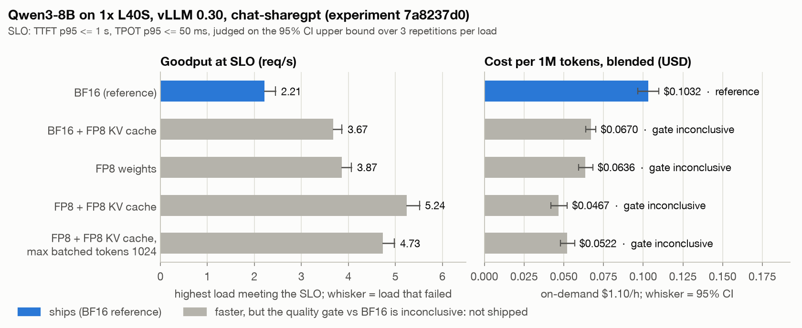
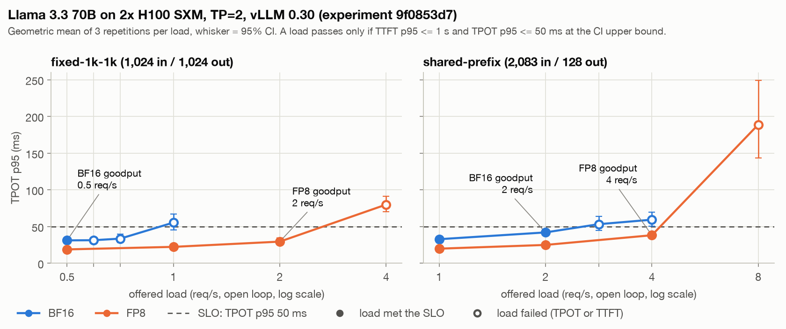
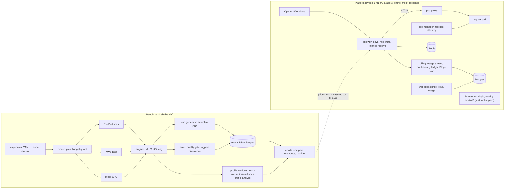

# Loom

## What Loom is

Loom is an open-source benchmark lab and serving platform for open-weight LLMs. For every
serving config (model, engine, precision, GPU, cloud) the lab measures **goodput at a
latency SLO** (the highest request rate that holds TTFT p95 ≤ 1 s and TPOT p95 ≤ 50 ms),
the **$ per 1M input and output tokens** that goodput implies, with 95% confidence
intervals over repeated runs, and **quality non-inferiority against BF16** (a paired
statistical gate on GSM8K, IFEval, tool calling and JSON-schema tasks, plus logprob
divergence). A config that is faster but does not pass the gate does not ship. The
platform half (an OpenAI-compatible gateway with prepaid, double-entry billing, a pool
manager, a web app and the Terraform for a production stack on AWS) is built through M1,
M2 and M3 Stage A and merged into `main`; it is tested offline on a mock GPU backend and
is not serving real traffic.

The results below come from real GPU runs on RunPod and AWS: $142.40 of recorded GPU spend in total, smokes, failed attempts and the since-removed TensorRT-LLM runs included.

Terms: **TTFT** is time to first token; **TPOT** is time per output token after the first
(how fast a reply streams); **ITL** is the gap between two tokens of one request, about
one engine decode step.

## Headline results

SLO for every row: TTFT p95 ≤ 1 s and TPOT p95 ≤ 50 ms, judged on the upper bound of the
95% CI over 3 repetitions per load. Goodput is searched on a grid, so it is a bracket: at
least the load shown, below the load that failed. Costs are on-demand list prices
including storage; "blended" is the replica's hourly cost over all tokens at the
workload's own input:output mix.

| Run | Config | Goodput at SLO | $/1M tokens, blended [95% CI] | Quality gate vs reference | Ships? |
|---|---|---|---|---|---|
| [9f0853d7](reports/70b-h100-v2/leaderboard.md) | Llama 3.3 70B **BF16**, 2x H100 SXM, TP=2, fixed-1k-1k | 0.5 req/s (fails at 0.59) | $2.37 [1.97, 2.84] | reference | reference row; **untrusted** (TTFT p95 varies 21.8% across repetitions) |
| 9f0853d7 + [9e5f7866](docs/benchmark-lab.md#70b-fp8-gate-on-tool-calling-data-version-2-9e5f7866-2026-10-09) | Llama 3.3 70B **FP8**, same pod | 2 req/s (fails at 4) | $0.546 [0.532, 0.561] | **PASS** on every task | **yes** |
| cf4d1614 | Llama 3.3 70B BF16, 4x L40S, TP=4 (GPUs split across CPU sockets) | none: TPOT p95 62.2 ms at the lowest load tested, 0.0625 req/s | n/a | n/a | no ([why](docs/writeups/70b-fp8-on-h100.md)) |
| [7a8237d0](reports/8b-config-sweep-v1/leaderboard.md) | Qwen3-8B **BF16**, 1x L40S, RunPod, chat | 2.213 req/s (fails at 2.449) | $0.1032 [0.0967, 0.1099] | reference | **yes** |
| 7a8237d0 | Qwen3-8B **FP8 weights + FP8 KV cache**, same GPU | 5.239 req/s (fails at 5.511) | $0.0467 [0.0418, 0.0522] | **INCONCLUSIVE** (GSM8K −0.28 pts [−1.14, +0.61] vs a 1-pt margin) | **no** |
| [95cde129](reports/8b-aws-g6e-v1/leaderboard.md) | Qwen3-8B BF16, AWS g6e.xlarge (1x L40S), chat | 2.213 req/s (fails at 2.449) | $0.1765 [0.1654, 0.1880] | reference | AWS reference row (serving runs on RunPod) |
| 95cde129 | Qwen3-8B FP8 + FP8 KV, AWS g6e.xlarge | 5.239 req/s (fails at 5.511) | $0.0799 [0.0714, 0.0893] | **FAIL** (IFEval −2.03 pts vs a 2-pt margin) | **no** |
| [fccf9ed3](reports/8b-aws-engines-v1/leaderboard.md) | Qwen3-8B BF16 on **SGLang 0.5.21** vs vLLM 0.30.0, AWS g6e.xlarge | 1.633 req/s (fails at 2) | $0.2453 [0.2019, 0.2980] | **FAIL** (strict tool calling −11.11 pts [−16.30, −5.93]) | **no** |
| [53e4c107](reports/8b-specdec-v1/leaderboard.md) | Qwen3-8B vLLM 0.30.0 BF16, no speculation (reference for the next row; its own host and day) | 2 req/s (fails at 3) | $0.2047 [0.1746, 0.2390] | reference | reference row; **untrusted** (throughput CV 10.8%) |
| 53e4c107 | Qwen3-8B vLLM BF16 + **EAGLE3** speculative decoding | ≥3 req/s (none failed) | ≤$0.1336 [0.1150, 0.1548] | **INCONCLUSIVE** (IFEval −0.49 pts [−2.16, +1.11] vs a 2-pt margin) | **no**; **untrusted** (TTFT p95 CV 13.2%) |

What these say:

- **70B: FP8 on NVLink H100s is the cheapest measured config that keeps quality.** On the same
  pod, FP8 holds 4x BF16's load on fixed-1k-1k (2 vs 0.5 req/s; 2,037 vs 470 output
  tok/s), so blended cost drops from $2.37 to $0.546 per 1M. FP8 passes the gate against
  BF16 on every task after the tool-calling set was grown from 60 to 135 items to make
  the gate able to decide. It is still 2.60x DeepInfra's $0.21 FP8 list price at this
  mix: we do not beat the cheapest providers at on-demand rates.
  [Write-up](docs/writeups/70b-fp8-on-h100.md).
- **4x L40S could not meet the SLO at any load.** RunPod placed the GPUs on two CPU
  sockets, every NCCL peer-to-peer setting hung, and with P2P disabled the decode floor
  is about 60 ms per token. EAGLE3 speculative decoding (55102ddb) cut median TPOT but
  not the p95.
- **8B: faster configs did not ship.** FP8 weights + FP8 KV cache serve chat at 2.4x
  BF16's rate for 45% of the cost, but the GSM8K gate stayed inconclusive on RunPod and
  IFEval failed on AWS. BF16 is the only shipped 8B row.
- **RunPod vs AWS, same GPU, same config** (95cde129 vs 7a8237d0): latency within normal
  variance at all 10 matched load points and identical knees; the AWS cost is 1.71x,
  entirely from the hourly price ($1.88/h vs $1.10/h).
- **vLLM vs SGLang on AWS** (fccf9ed3): vLLM holds 36% more load at the SLO (2.213 vs
  1.633 req/s) and costs 28% less per 1M tokens. In 14 of SGLang's 18 strict tool-calling
  failures the constrained call picked the wrong function.
  **SGLang 0.5.21 fails strict tool calling (−11.11 pts).** Its Qwen3 tool parser (`Qwen25Detector`) forces the prefix `<tool_call>\n{"name":"` where Qwen3's chat template writes `{"name": "`: the same kind of whitespace mismatch that made TensorRT-LLM fail strict tool calling. A plausible cause, not a tested one.
- **Why FP8 + FP8 KV gave 2.4x and not more** (profile 14d959e5). A batch-1 BF16 step is
  22.17 ms, 20.85 ms of it GEMMs streaming weights at 84% of the L40S's 864 GB/s. FP8 reads
  about half the bytes but its step is only 1.36x faster: FP8 GEMMs reach 57-72% of
  bandwidth, quantization adds 0.61 ms, and the GPU idles 1.04 ms while the CPU blocks on a
  GPU-to-CPU copy. Decode alone would give ~2.8-3.1x, but FP8 prefill is only 1.34x faster per token,
  so prompt-carrying steps take 33% of its GPU time (17% for BF16) and set the p95 tail.
  [Roofline and profiling](docs/perf/roofline-and-profiling.md).
- **Speculative decoding: EAGLE3 about 2x faster per token on chat, at every load.**
  TPOT p50 fell 2.00-2.31x with EAGLE3 (2.29-2.34 tokens per verify step), 1.01-1.08x
  with n-gram, which finds little to copy in chat; on code edits, which copy the prompt,
  n-gram gave 3.02-3.09x and EAGLE3 2.69-2.70x. The textbook fade at high batch never
  appeared: a request that streams twice as fast is in flight half as long, so at 3 req/s
  EAGLE3 ran 18.6 requests at once against 40.3 and never got busy enough for wasted
  verifies to cost. Its few slow chat replies were mostly in languages whose tokens its
  32,000-token draft vocabulary lacks. Not concluded: the gates (inconclusive on IFEval
  only; logprob divergence at BF16's own noise floor) and the crossover load.
  [Speculative decoding](docs/perf/speculative-decoding.md).





Charts are drawn by [scripts/readme_charts.py](scripts/readme_charts.py) from the
committed report CSVs and a per-load extract of 9f0853d7
([docs/img/data](docs/img/data/70b-h100-9f0853d7-load-sweep.csv)). On fixed-1k-1k, BF16
fails at 0.59 and 0.71 req/s on TTFT, not TPOT. Full reports, with every config hash,
image digest and `bench reproduce` command, are in [reports/](reports/); the run
narratives are in [docs/benchmark-lab.md](docs/benchmark-lab.md#phase-0-experiments).

## How it measures

- **Goodput by load search at the SLO.** Open-loop Poisson arrivals at a set rate, 3
  repetitions per load. A load passes only if the CI upper bound of every target is within
  the SLO; the search descends, bisects and reports the bracket. Cost at SLO = hourly price
  / goodput throughput, split into input and output by measured prefill time.
- **Confidence intervals everywhere.** Latencies and throughputs use log-scale Student-t
  intervals (geometric means); a result whose run-to-run CV exceeds 10% is marked
  untrusted and is not ranked.
- **Quality gate.** Candidate vs reference scores are paired by item; the 95% CI is a
  paired bootstrap over items, widened to at least ±3/n. PASS needs the CI's lower bound
  above −margin (1 pt GSM8K, 2 pts IFEval, 3 pts JSON schema, 6 pts tool calling); a
  point drop beyond the margin is a FAIL; anything else is INCONCLUSIVE and blocks the
  config. Teacher-forced logprob divergence (KL, top-1 agreement) and output sanity checks
  run alongside. [docs/quality-gate.md](docs/quality-gate.md)
- **The gate in practice:** it blocked TensorRT-LLM 1.4.0rc2 (benchmarked in November 2026, since removed from Loom) on strict tool calling alone, and the cause was an upstream parser bug: its grammar forbids the spaces Qwen3's chat template writes before the function name ([NVIDIA/TensorRT-LLM#21903](https://github.com/NVIDIA/TensorRT-LLM/issues/21903), fix in [PR #21906](https://github.com/NVIDIA/TensorRT-LLM/pull/21906)).
- **Provenance.** Each config is hashed over model revision, engine image digest, launch
  args and hardware; each run stores the git SHA, CUDA and driver versions, GPU topology
  and dataset versions, so
  `bench reproduce <id>` reruns it and `bench compare` judges the difference.
- **Spend rails.** A planner refuses any experiment whose estimate or TTL worst case
  exceeds its cap; a budget guard accrues spend live and aborts at the cap; every pod or
  instance carries a self-terminating TTL watchdog; scheduled reaper Lambdas (AWS and
  RunPod) remove anything past its TTL. A paid run on a new code path goes after a smoke
  test that exercises the same paths at small scale (smokes are in the spend figure).

## Run it

Needs [uv](https://docs.astral.sh/uv/). No GPU and no cloud account for any of this.

```bash
uv sync
mkdir -p results && export LOOM_DATABASE_URL=sqlite:///results/loom.db
uv run bench run bench/experiments/mock-smoke.yaml   # about 30 s on the simulated GPU
uv run bench report                                  # leaderboard in reports/
uv run bench site build                              # results site in site/_build/
```

- **Tests:** `uv run pytest -q` (`-n auto` runs them in parallel). The code is POSIX-first:
  on native Windows the gateway's tests do not collect, so run them in WSL, Docker or CI
  and pass the other test directories explicitly. With Docker, `docker compose up -d
  postgres redis` starts the servers the Postgres and Redis tests use (they skip silently
  without one), and `docker compose up -d postgres` gives the default results database
  instead of SQLite (unset `LOOM_DATABASE_URL`).
- **The local platform stack:** `docker compose up -d --build --wait`, then
  `uv run loom-m1-acceptance`. It uses mock pods and a Stripe stub and is free
  ([docs/local-dev.md](docs/local-dev.md#m1-acceptance)).
- **Real GPU runs cost money.** `bench run` and `bench reproduce` on RunPod or AWS specs
  start paid pods or instances: read the preflight in
  [docs/runbook-runpod.md](docs/runbook-runpod.md) (RunPod, the primary path) or
  [docs/runbook.md](docs/runbook.md) (AWS), check the estimate with `bench plan <spec>`
  (it only estimates), and run the smoke spec on the same commit first.

## Status

- **Phase 0, Benchmark Lab: done and accepted** (2026-10-31). Checklist:
  [docs/phase0-acceptance.md](docs/phase0-acceptance.md).
- **Phase 1, M1 (whole platform locally, mock backend): built and accepted locally**
  (2026-11-01), merged into `main`. **M2 (the pool manager, offline)** is merged too
  (2026-11-16, PR #8), and the review follow-ups due before M3 were fixed in three PRs
  (#12-#14; [docs/phase1-runpod-plan.md](docs/phase1-runpod-plan.md#follow-ups-from-the-m1-pre-merge-review-2026-11-15)).
- **M3 Stage A (free: code, tests, runbooks, Terraform up to `terraform plan`)** was
  merged into `main` on 2026-11-20 (PR #15). It is offline and mock: nothing is applied,
  nothing serves traffic. Still open: A28 (`terraform plan` with the user's read-only
  credentials). **Stage B** (`terraform apply`, DNS, deploy, the live acceptance,
  teardown) has not run: it spends money and needs a separate yes with its cap
  ([docs/phase1-m3-acceptance.md](docs/phase1-m3-acceptance.md)).
- **Perf track (profiling and roofline, speculative decoding): runs done**
  (2026-11-03 to 2026-11-05), results above. Open follow-up, not approved or run:
  settling the EAGLE3 IFEval gate.
- The public results site is built but not published.

**GPU spend:** $142.40 recorded in the results database across 41 experiments, smokes and
failed attempts included (the TensorRT-LLM runs too), against a $249.75 overall cap (raised from $149.75 on
2026-11-02). A few manual diagnostic pods outside the runner (for example the $3.40 70B
tuning pod) are not in that figure.

## Architecture



The platform code is in `services/` (gateway, billing, pod proxy, pool manager) and
`apps/web/`; `infra/aws/` and `deploy/` hold the production stack's Terraform and deploy
tooling (built, not applied). Its M1 acceptance runs on the local compose stack with mock pods
([docs/phase1-m1-acceptance.md](docs/phase1-m1-acceptance.md)): gateway p50 added overhead 4.9 ms,
0 micro-dollars of balance overshoot under 64 concurrent requests, a revoked key refused
3 ms after the revoke commits, and usage in the ledger equal to the engine's token counts,
including aborted streams and a killed pod.

## Docs

- [docs/README.md](docs/README.md) indexes everything: architecture, local development,
  running experiments, the quality gate, the cost model, the Phase 1 plan and specs,
  runbooks, security, and how to add a model, engine, GPU type, workload or eval task.
- [docs/writeups/70b-fp8-on-h100.md](docs/writeups/70b-fp8-on-h100.md): serving Llama
  3.3 70B cheaply, from a cross-socket dead end to FP8 on H100.
- [docs/perf/roofline-and-profiling.md](docs/perf/roofline-and-profiling.md): each decode
  step against the hardware floor, and where the rest goes (GPU traces, 14d959e5).
- [docs/perf/speculative-decoding.md](docs/perf/speculative-decoding.md): n-gram vs EAGLE3
  drafts on chat and code edits.
- [docs/PLAN.md](docs/PLAN.md): the overall plan and decisions.

## License

Licensed under Apache-2.0.
