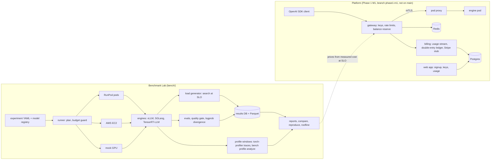

# Loom

Loom is an open-source benchmark lab and serving platform for open-weight LLMs. For every
serving config (model, engine, precision, GPU, cloud) the lab measures **goodput at a
latency SLO** (the highest request rate that holds TTFT p95 ≤ 1 s and TPOT p95 ≤ 50 ms),
the **$ per 1M input and output tokens** that goodput implies, with 95% confidence
intervals over repeated runs, and **quality non-inferiority against BF16** (a paired
statistical gate on GSM8K, IFEval, tool calling and JSON-schema tasks, plus logprob
divergence). A config that is faster but does not pass the gate does not ship. The
platform half (an OpenAI-compatible gateway with prepaid, double-entry billing, and a web
app) is built to its first milestone on branch `phase1-m1`, not on `main`; it is
tested locally on a mock GPU backend, not yet serving real traffic.

All results below come from real GPU runs on RunPod and AWS, $142.40 of recorded GPU
spend in total.

Terms: **TTFT** is time to first token; **TPOT** is time per output token after the first
(how fast a reply streams); **ITL** is the gap between two tokens of one request, about
one engine decode step.

## Performance deep dives

Each starts in plain language, then gives the math and traces; every figure names its run.

- [Roofline and profiling](docs/perf/roofline-and-profiling.md): each decode step against
  the hardware floor, and where the rest goes (GPU traces, 14d959e5). Why FP8 + FP8 KV
  cache gave 2.4x the goodput and not more.
- [TensorRT-LLM as a third engine](docs/perf/tensorrt-llm.md): NVIDIA's engine vs vLLM on
  the same GPU, model and SLO. Why its BF16 was slower, what capped its FP8, and why the
  quality gate failed both.
- [Speculative decoding](docs/perf/speculative-decoding.md): n-gram vs EAGLE3 drafts on
  chat and code edits. When guessing tokens pays, and why the gain grew with load here.

## Results

SLO for every row: TTFT p95 ≤ 1 s and TPOT p95 ≤ 50 ms, judged on the upper bound of the
95% CI over 3 repetitions per load. Goodput is searched on a grid, so it is a bracket: at
least the load shown, below the load that failed. Costs are on-demand list prices
including storage; "blended" is the replica's hourly cost over all tokens at the
workload's own input:output mix.

| Run | Config | Goodput at SLO | $/1M tokens, blended [95% CI] | Quality gate vs reference | Ships? |
|---|---|---|---|---|---|
| [9f0853d7](reports/70b-h100-v2/leaderboard.md) | Llama 3.3 70B **BF16**, 2x H100 SXM, TP=2, fixed-1k-1k | 0.5 req/s (fails at 0.59) | $2.37 [1.97, 2.84] | reference | reference row; **untrusted** (TTFT p95 varies 21.8% across repetitions) |
| 9f0853d7 + [9e5f7866](docs/benchmark-lab.md#70b-fp8-gate-on-tool-calling-data-version-2-9e5f7866-2026-10-09) | Llama 3.3 70B **FP8**, same pod | 2 req/s (fails at 4) | $0.546 [0.532, 0.561] | **PASS** on every task | **yes** |
| cf4d1614 | Llama 3.3 70B BF16, 4x L40S, TP=4 (GPUs split across CPU sockets) | none: TPOT p95 62.2 ms at the lowest load tested, 0.0625 req/s | n/a | n/a | no ([why](docs/writeups/70b-fp8-on-h100.md)) |
| [7a8237d0](reports/8b-config-sweep-v1/leaderboard.md) | Qwen3-8B **BF16**, 1x L40S, RunPod, chat | 2.213 req/s (fails at 2.449) | $0.1032 [0.0967, 0.1099] | reference | **yes** |
| 7a8237d0 | Qwen3-8B **FP8 weights + FP8 KV cache**, same GPU | 5.239 req/s (fails at 5.511) | $0.0467 [0.0418, 0.0522] | **INCONCLUSIVE** (GSM8K −0.28 pts [−1.14, +0.61] vs a 1-pt margin) | **no** |
| [95cde129](reports/8b-aws-g6e-v1/leaderboard.md) | Qwen3-8B BF16, AWS g6e.xlarge (1x L40S), chat | 2.213 req/s (fails at 2.449) | $0.1765 [0.1654, 0.1880] | reference | AWS reference row (serving runs on RunPod) |
| 95cde129 | Qwen3-8B FP8 + FP8 KV, AWS g6e.xlarge | 5.239 req/s (fails at 5.511) | $0.0799 [0.0714, 0.0893] | **FAIL** (IFEval −2.03 pts vs a 2-pt margin) | **no** |
| [fccf9ed3](reports/8b-aws-engines-v1/leaderboard.md) | Qwen3-8B BF16 on **SGLang 0.5.21** vs vLLM 0.30.0, AWS g6e.xlarge | 1.633 req/s (fails at 2) | $0.2453 [0.2019, 0.2980] | **FAIL** (strict tool calling −11.11 pts [−16.30, −5.93]) | **no** |

What these say:

- **70B: FP8 on NVLink H100s is the cheapest measured config that keeps quality.** On the same
  pod, FP8 holds 4x BF16's load on fixed-1k-1k (2 vs 0.5 req/s; 2,037 vs 470 output
  tok/s), so blended cost drops from $2.37 to $0.546 per 1M. FP8 passes the gate against
  BF16 on every task after the tool-calling set was grown from 60 to 135 items to make
  the gate able to decide. It is still 2.60x DeepInfra's $0.21 FP8 list price at this
  mix: we do not beat the cheapest providers at on-demand rates.
  [Write-up](docs/writeups/70b-fp8-on-h100.md).
- **4x L40S could not meet the SLO at any load.** RunPod placed the GPUs on two CPU
  sockets, every NCCL peer-to-peer setting hung, and with P2P disabled the decode floor
  is about 60 ms per token. EAGLE3 speculative decoding (55102ddb) cut median TPOT but
  not the p95.
- **8B: faster configs did not ship.** FP8 weights + FP8 KV cache serve chat at 2.4x
  BF16's rate for 45% of the cost, but the GSM8K gate stayed inconclusive on RunPod and
  IFEval failed on AWS. BF16 is the only shipped 8B row.
- **RunPod vs AWS, same GPU, same config** (95cde129 vs 7a8237d0): latency within normal
  variance at all 10 matched load points and identical knees; the AWS cost is 1.71x,
  entirely from the hourly price ($1.88/h vs $1.10/h).
- **vLLM vs SGLang on AWS** (fccf9ed3): vLLM holds 36% more load at the SLO (2.213 vs
  1.633 req/s) and costs 28% less per 1M tokens. SGLang also fails the gate on strict
  tool calling: in 14 of its 18 failures the constrained call picked the wrong function.
- **Why FP8 + FP8 KV gave 2.4x and not more** (profile 14d959e5). A batch-1 BF16 step is
  22.17 ms, 20.85 ms of it GEMMs streaming weights at 84% of the L40S's 864 GB/s. FP8 reads
  about half the bytes but its step is only 1.36x faster: FP8 GEMMs reach 57-72% of
  bandwidth, quantization adds 0.61 ms, and the GPU idles 1.04 ms while the CPU blocks on a
  GPU-to-CPU copy. Decode alone would give ~2.8-3.1x, but FP8 prefill is only 1.34x faster per token,
  so prompt-carrying steps take 33% of its GPU time (17% for BF16) and set the p95 tail.


Charts are drawn by [scripts/readme_charts.py](scripts/readme_charts.py) from the
committed report CSVs and a per-load extract of 9f0853d7
([docs/img/data](docs/img/data/70b-h100-9f0853d7-load-sweep.csv)). On fixed-1k-1k, BF16
fails at 0.59 and 0.71 req/s on TTFT, not TPOT. Full reports, with every config hash,
image digest and `bench reproduce` command, are in [reports/](reports/); the run
narratives are in [docs/benchmark-lab.md](docs/benchmark-lab.md#phase-0-experiments).

### Perf track: TensorRT-LLM and speculative decoding

Qwen3-8B, AWS g6e.xlarge (1x L40S), chat, same SLO and search as above. Each block has its
own vLLM BF16 reference cell (46938d1f, 53e4c107: different hosts and days).

| Run | Config | Goodput at SLO | $/1M tokens, blended [95% CI] | Quality gate vs vLLM BF16 | Ships? |
|---|---|---|---|---|---|
| [46938d1f](reports/8b-trtllm-v1/leaderboard.md) | vLLM 0.30.0 **BF16** (reference for the TensorRT-LLM rows) | 2.25 req/s (fails at 2.367) | $0.1859 [0.1650, 0.2092] | reference | reference row |
| 46938d1f + [9647a23b](docs/perf/tensorrt-llm.md#the-quality-gate-blocked-only-by-strict-tool-calling) | **TensorRT-LLM 1.4.0rc2 BF16** | 1.355 req/s (fails at 1.5) | $0.3118 [0.2504, 0.3882] | **FAIL** (strict tool calling −13.83 pts [−19.75, −8.15]; upstream parser bug, below) | **no**; **untrusted** (TTFT p95 CV 13.9%) |
| [08204560](reports/8b-trtllm-v1/leaderboard.md) | TensorRT-LLM **FP8** (ModelOpt FP8 weights + FP8 KV), engine defaults | 2.49 req/s (fails at 2.619) | $0.1654 [0.1516, 0.1803] | **FAIL** (strict tool calling −11.36 pts [−17.04, −6.17]) | **no** |
| [ad5b1408](reports/8b-trtllm-why-v1/README.md) | TensorRT-LLM FP8 with CUDA-graph padding | ≥3.375 req/s (none failed) | ≤$0.1237 [0.1090, 0.1404] | GSM8K and divergence only (pass); same engine grammar, so strict tools would fail too | comparison point, **not ranked** |
| [53e4c107](reports/8b-specdec-v1/leaderboard.md) | vLLM 0.30.0 BF16, no speculation (reference) | 2 req/s (fails at 3) | $0.2047 [0.1746, 0.2390] | reference | reference row; **untrusted** (throughput CV 10.8%) |
| 53e4c107 | vLLM BF16 + **EAGLE3** speculative decoding | ≥3 req/s (none failed) | ≤$0.1336 [0.1150, 0.1548] | **INCONCLUSIVE** (IFEval −0.49 pts [−2.16, +1.11] vs a 2-pt margin) | **no**; **untrusted** (TTFT p95 CV 13.2%) |

What these say:

- **TensorRT-LLM BF16 is slower because of decode attention, not matrix multiplies.** It
  held 1.355 req/s against vLLM's 2.25 (0.667 vs 1.0 on 1k-in/1k-out), 1.68x the cost.
  The traces (71e2c32c vs 14d959e5) show both engines running the *same* cuBLAS GEMM
  kernel through PyTorch, GEMM time within 2-3% at every batch. The gap is TensorRT-LLM's
  XQA decode-attention kernel, 1.14-1.19x vLLM's FlashAttention split-KV time: the step
  gap grows from +0.16 ms at batch 1 to +7.0 ms at 64, 76-95% of it attention, and ~2 ms
  per step at chat's batch of ~25 moves the 50 ms TPOT knee. Not concluded: *why* XQA is
  slower on this GPU (needs Nsight Compute), or whether another attention backend helps.
- **TensorRT-LLM FP8's limit was missing CUDA graphs, not FP8.** Its steps run 17-19 ms
  until the running batch passes ~32, then jump to 47-50 ms. By default 1.4.0rc2 captures
  CUDA graphs only for decode batches 1-32, 64 and 128, padding off, so batches of 33-63
  launch every kernel from Python (in the BF16 trace such steps left the GPU idle 12-64
  ms, ~0.1 ms with a graph). On the same seeded arrivals stock FP8 collapsed on the same 3
  of 6 traces in two runs; with `enable_padding: true`, 0 of 6 (ITL p50 16.8-18.4 ms), and
  it held the SLO at every tested load. Not concluded: where the padded knee is.
- **A second FP8 problem, at light load only.** With an FP8 KV cache at batch ≤4, attention
  falls back from XQA to the older MMHA kernel: a batch-4 step took 79.5 ms (67.4 ms of it
  attention) against 14.0 ms at batch 5. The dispatch rule is read from source, not traced.
- **The gate caught an upstream TensorRT-LLM bug.** Both TensorRT-LLM configs match vLLM
  on math, plain tool calling, JSON schema and logprobs (BF16 KL 0.0006 nats, inside
  vLLM's own run-to-run noise) and fail only strict tool calling, almost all as
  wrong-function picks on multi-tool items. In 1.4.0rc2, `Qwen3ToolParser.structure_info`
  forces the prefix `<tool_call>\n{"name":"` where Qwen3's chat template writes
  `{"name": "` (the space after `"arguments":` is missing too), so the model is pushed off
  its usual tokens exactly where it names the function. A deterministic CPU repro
  (tokenizer, chat template and xgrammar; no GPU) shows the grammar rejecting the
  template's own tokens and accepting them once the spaces are restored. SGLang's
  `Qwen25Detector` has the same string, a plausible but untested cause of SGLang's
  strict-tool failure above. On GPU (Qwen3-8B BF16, L40S), a 45-request multi-tool test
  scored 27/45 with the stock grammar and 45/45 with both spaces restored (repro on branch
  [`trtllm-qwen3-strict-repro`](https://github.com/arulster17/loom/tree/trtllm-qwen3-strict-repro/repro)).
  Reported upstream as [NVIDIA/TensorRT-LLM#21903](https://github.com/NVIDIA/TensorRT-LLM/issues/21903),
  with a fix in [PR #21906](https://github.com/NVIDIA/TensorRT-LLM/pull/21906) (open, in review).
- **Speculative decoding: EAGLE3 about 2x faster per token on chat, at every load.**
  TPOT p50 fell 2.00-2.31x with EAGLE3 (2.29-2.34 tokens per verify step), 1.01-1.08x
  with n-gram, which finds little to copy in chat; on code edits, which copy the prompt,
  n-gram gave 3.02-3.09x and EAGLE3 2.69-2.70x. The textbook fade at high batch never
  appeared: a request that streams twice as fast is in flight half as long, so at 3 req/s
  EAGLE3 ran 18.6 requests at once against 40.3 and never got busy enough for wasted
  verifies to cost. Its few slow chat replies were mostly in languages whose tokens its
  32,000-token draft vocabulary lacks. Not concluded: the gates (inconclusive on IFEval
  only; logprob divergence at BF16's own noise floor) and the crossover load.

## Methodology

- **Goodput by load search at the SLO.** Open-loop Poisson arrivals at a set rate, 3
  repetitions per load. A load passes only if the CI upper bound of every target is within
  the SLO; the search descends, bisects and reports the bracket. Cost at SLO = hourly price
  / goodput throughput, split into input and output by measured prefill time.
- **Confidence intervals everywhere.** Latencies and throughputs use log-scale Student-t
  intervals (geometric means); a result whose run-to-run CV exceeds 10% is marked
  untrusted and is not ranked.
- **Quality gate.** Candidate vs reference scores are paired by item; the 95% CI is a
  paired bootstrap over items, widened to at least ±3/n. PASS needs the CI's lower bound
  above −margin (1 pt GSM8K, 2 pts IFEval, 3 pts JSON schema, 6 pts tool calling); a
  point drop beyond the margin is a FAIL; anything else is INCONCLUSIVE and blocks the
  config. Teacher-forced logprob divergence (KL, top-1 agreement) and output sanity checks
  run alongside. [docs/quality-gate.md](docs/quality-gate.md)
- **Provenance.** Each config is hashed over model revision, engine image digest, launch
  args and hardware; each run stores the git SHA, CUDA and driver versions, GPU topology
  and dataset versions, so
  `bench reproduce <id>` reruns it and `bench compare` judges the difference.
- **Spend rails.** A planner refuses any experiment whose estimate or TTL worst case
  exceeds its cap; a budget guard accrues spend live and aborts at the cap; every pod or
  instance carries a self-terminating TTL watchdog; scheduled reaper Lambdas (AWS and
  RunPod) remove anything past its TTL. A paid run on a new code path goes after a smoke
  test that exercises the same paths at small scale (smokes are in the spend figure).

## Architecture



The platform code (gateway, billing, web) is on branch `phase1-m1`, not on `main`.
Its M1 acceptance runs on the local compose stack with mock pods
(`docs/phase1-m1-acceptance.md` on that branch): gateway p50 added overhead 4.9 ms,
0 micro-dollars of balance overshoot under 64 concurrent requests, a revoked key refused
3 ms after the revoke commits, and usage in the ledger equal to the engine's token counts,
including aborted streams and a killed pod.

## Status

- **Phase 0, Benchmark Lab: done and accepted** (2026-10-31). Checklist:
  [docs/phase0-acceptance.md](docs/phase0-acceptance.md).
- **Phase 1, M1 (whole platform locally, mock backend): built on branch `phase1-m1`,
  paused.** It is not on `main`. Real pods on RunPod are the next milestone.
- **Perf track (profiling and roofline, TensorRT-LLM, speculative decoding): runs done**
  (2026-11-03 to 2026-11-05), results above. Open follow-ups, none approved or run:
  Nsight Compute on the XQA kernel, re-running the full quality gate on TensorRT-LLM with
  the tool-parser fix (only the 45-request strict-tool repro has been run), the padded FP8 knee, and settling the EAGLE3 IFEval gate.
- The public results site is built but not published.

**GPU spend:** $142.40 recorded in the results database across 41 experiments, smokes and
failed attempts included, against a $249.75 overall cap (raised from $149.75 on
2026-11-02). A few manual diagnostic pods outside the runner (for example the $3.40 70B
tuning pod) are not in that figure.

## Quick start (no GPU, no cloud)

Needs [uv](https://docs.astral.sh/uv/).

```bash
uv sync
mkdir -p results && export LOOM_DATABASE_URL=sqlite:///results/loom.db
uv run bench run bench/experiments/mock-smoke.yaml   # about 30 s on the simulated GPU
uv run bench report                                  # leaderboard in reports/
uv run bench site build                              # results site in site/_build/
```

`uv run pytest -q` runs the test suite. With Docker, `docker compose up -d postgres`
gives the default results database instead of SQLite (unset `LOOM_DATABASE_URL`). The
platform stack and its acceptance run are on branch `phase1-m1`.

## Docs

- [docs/writeups/70b-fp8-on-h100.md](docs/writeups/70b-fp8-on-h100.md): serving Llama
  3.3 70B cheaply, from a cross-socket dead end to FP8 on H100.
- [docs/README.md](docs/README.md) indexes everything else: architecture, local
  development, running experiments, the quality gate, the cost model, runbooks, security,
  and how to add a model, engine, GPU type, workload or eval task.

Licensed under Apache-2.0.
