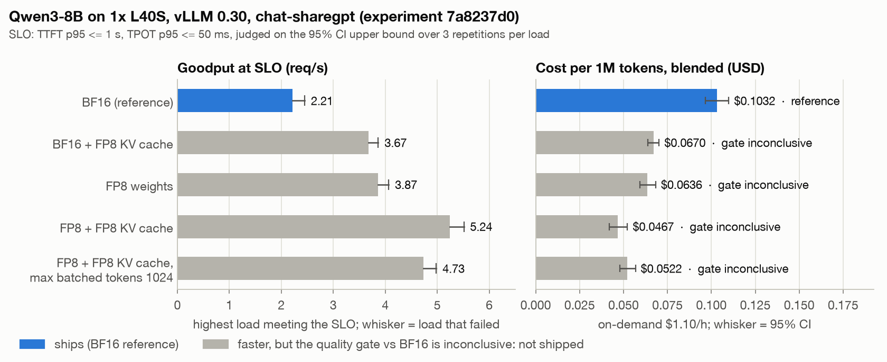
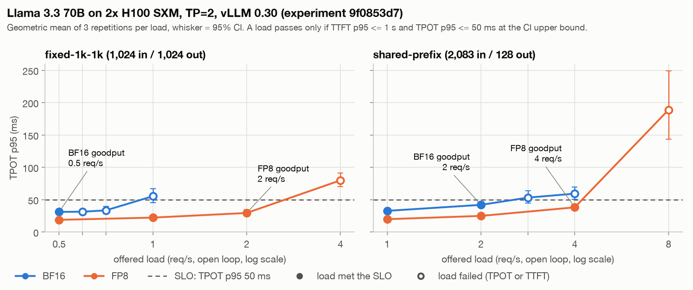
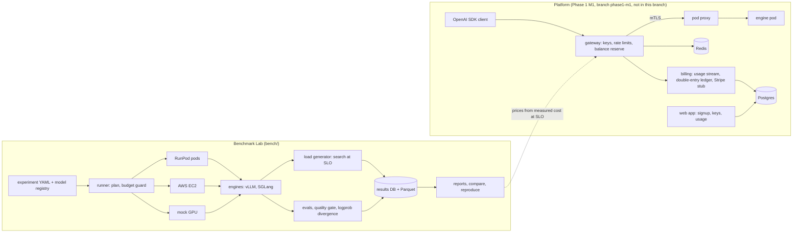

# Loom

Loom is an open-source benchmark lab and serving platform for open-weight LLMs. For every
serving config (model, engine, precision, GPU, cloud) the lab measures **goodput at a
latency SLO** (the highest request rate that holds TTFT p95 ≤ 1 s and TPOT p95 ≤ 50 ms),
the **$ per 1M input and output tokens** that goodput implies, with 95% confidence
intervals over repeated runs, and **quality non-inferiority against BF16** (a paired
statistical gate on GSM8K, IFEval, tool calling and JSON-schema tasks, plus logprob
divergence). A config that is faster but does not pass the gate does not ship. The
platform half (an OpenAI-compatible gateway with prepaid, double-entry billing, and a web
app) is being built on branch `phase1-m1` and is not in this branch; it is tested locally
on a mock GPU backend, not yet serving real traffic.

All results below come from real GPU runs on RunPod and AWS, $96.57 of recorded GPU
spend in total.

## Results

SLO for every row: TTFT p95 ≤ 1 s and TPOT p95 ≤ 50 ms, judged on the upper bound of the
95% CI over 3 repetitions per load. Goodput is searched on a grid, so it is a bracket: at
least the load shown, below the load that failed. Costs are on-demand list prices
including storage; "blended" is the replica's hourly cost over all tokens at the
workload's own input:output mix.

| Run | Config | Goodput at SLO | $/1M tokens, blended [95% CI] | Quality gate vs reference | Ships? |
|---|---|---|---|---|---|
| [9f0853d7](reports/70b-h100-v2/leaderboard.md) | Llama 3.3 70B **BF16**, 2x H100 SXM, TP=2, fixed-1k-1k | 0.5 req/s (fails at 0.59) | $2.37 [1.97, 2.84] | reference | reference row; **untrusted** (TTFT p95 varies 21.8% across repetitions) |
| 9f0853d7 + [9e5f7866](docs/benchmark-lab.md#70b-fp8-gate-on-tool-calling-data-version-2-9e5f7866-2026-10-09) | Llama 3.3 70B **FP8**, same pod | 2 req/s (fails at 4) | $0.546 [0.532, 0.561] | **PASS** on every task | **yes** |
| cf4d1614 | Llama 3.3 70B BF16, 4x L40S, TP=4 (GPUs split across CPU sockets) | none: TPOT p95 62.2 ms at the lowest load tested, 0.0625 req/s | n/a | n/a | no ([why](docs/writeups/70b-fp8-on-h100.md)) |
| [7a8237d0](reports/8b-config-sweep-v1/leaderboard.md) | Qwen3-8B **BF16**, 1x L40S, RunPod, chat | 2.213 req/s (fails at 2.449) | $0.1032 [0.0967, 0.1099] | reference | **yes** |
| 7a8237d0 | Qwen3-8B **FP8 weights + FP8 KV cache**, same GPU | 5.239 req/s (fails at 5.511) | $0.0467 [0.0418, 0.0522] | **INCONCLUSIVE** (GSM8K −0.28 pts [−1.14, +0.61] vs a 1-pt margin) | **no** |
| [95cde129](reports/8b-aws-g6e-v1/leaderboard.md) | Qwen3-8B BF16, AWS g6e.xlarge (1x L40S), chat | 2.213 req/s (fails at 2.449) | $0.1765 [0.1654, 0.1880] | reference | AWS reference row (serving runs on RunPod) |
| 95cde129 | Qwen3-8B FP8 + FP8 KV, AWS g6e.xlarge | 5.239 req/s (fails at 5.511) | $0.0799 [0.0714, 0.0893] | **FAIL** (IFEval −2.03 pts vs a 2-pt margin) | **no** |
| [fccf9ed3](reports/8b-aws-engines-v1/leaderboard.md) | Qwen3-8B BF16 on **SGLang 0.5.21** vs vLLM 0.30.0, AWS g6e.xlarge | 1.633 req/s (fails at 2) | $0.2453 [0.2019, 0.2980] | **FAIL** (strict tool calling −11.11 pts [−16.30, −5.93]) | **no** |

What these say:

- **70B: FP8 on NVLink H100s is the cheapest measured config that keeps quality.** On the same
  pod, FP8 holds 4x BF16's load on fixed-1k-1k (2 vs 0.5 req/s; 2,037 vs 470 output
  tok/s), so blended cost drops from $2.37 to $0.546 per 1M. FP8 passes the gate against
  BF16 on every task after the tool-calling set was grown from 60 to 135 items to make
  the gate able to decide. It is still 2.60x DeepInfra's $0.21 FP8 list price at this
  mix: we do not beat the cheapest providers at on-demand rates.
  [Write-up](docs/writeups/70b-fp8-on-h100.md).
- **4x L40S could not meet the SLO at any load.** RunPod placed the GPUs on two CPU
  sockets, every NCCL peer-to-peer setting hung, and with P2P disabled the decode floor
  is about 60 ms per token. EAGLE3 speculative decoding (55102ddb) cut median TPOT but
  not the p95.
- **8B: faster configs did not ship.** FP8 weights + FP8 KV cache serve chat at 2.4x
  BF16's rate for 45% of the cost, but the GSM8K gate stayed inconclusive on RunPod and
  IFEval failed on AWS. BF16 is the only shipped 8B row.
- **RunPod vs AWS, same GPU, same config** (95cde129 vs 7a8237d0): latency within normal
  variance at all 10 matched load points and identical knees; the AWS cost is 1.71x,
  entirely from the hourly price ($1.88/h vs $1.10/h).
- **vLLM vs SGLang on AWS** (fccf9ed3): vLLM holds 36% more load at the SLO (2.213 vs
  1.633 req/s) and costs 28% less per 1M tokens. SGLang also fails the gate on strict
  tool calling: in 14 of its 18 failures the constrained call picked the wrong function.





Charts are drawn by [scripts/readme_charts.py](scripts/readme_charts.py) from the
committed report CSVs and a per-load extract of 9f0853d7
([docs/img/data](docs/img/data/70b-h100-9f0853d7-load-sweep.csv)). On fixed-1k-1k, BF16
fails at 0.59 and 0.71 req/s on TTFT, not TPOT. Full reports, with every config hash,
image digest and `bench reproduce` command, are in [reports/](reports/); the run
narratives are in [docs/benchmark-lab.md](docs/benchmark-lab.md#phase-0-experiments).

## Methodology

- **Goodput by load search at the SLO.** Open-loop Poisson arrivals at a set rate, 3
  repetitions per load. A load passes only if the CI upper bound of every target is within
  the SLO; the search descends, bisects and reports the bracket. Cost at SLO = hourly price
  / goodput throughput, split into input and output by measured prefill time.
- **Confidence intervals everywhere.** Latencies and throughputs use log-scale Student-t
  intervals (geometric means); a result whose run-to-run CV exceeds 10% is marked
  untrusted and is not ranked.
- **Quality gate.** Candidate vs reference scores are paired by item; the 95% CI is a
  paired bootstrap over items, widened to at least ±3/n. PASS needs the CI's lower bound
  above −margin (1 pt GSM8K, 2 pts IFEval, 3 pts JSON schema, 6 pts tool calling); a
  point drop beyond the margin is a FAIL; anything else is INCONCLUSIVE and blocks the
  config. Teacher-forced logprob divergence (KL, top-1 agreement) and output sanity checks
  run alongside. [docs/quality-gate.md](docs/quality-gate.md)
- **Provenance.** Each config is hashed over model revision, engine image digest, launch
  args and hardware; each run stores the git SHA, CUDA and driver versions, GPU topology
  and dataset versions, so
  `bench reproduce <id>` reruns it and `bench compare` judges the difference.
- **Spend rails.** A planner refuses any experiment whose estimate or TTL worst case
  exceeds its cap; a budget guard accrues spend live and aborts at the cap; every pod or
  instance carries a self-terminating TTL watchdog; scheduled reaper Lambdas (AWS and
  RunPod) remove anything past its TTL. A paid run on a new code path goes after a smoke
  test that exercises the same paths at small scale (smokes are in the spend figure).

## Architecture



The platform code (gateway, billing, web) is on branch `phase1-m1`, not in this branch.
Its M1 acceptance runs on the local compose stack with mock pods
(`docs/phase1-m1-acceptance.md` on that branch): gateway p50 added overhead 4.9 ms,
0 micro-dollars of balance overshoot under 64 concurrent requests, a revoked key refused
3 ms after the revoke commits, and usage in the ledger equal to the engine's token counts,
including aborted streams and a killed pod.

## Status

- **Phase 0, Benchmark Lab: done and accepted** (2026-10-31). Checklist:
  [docs/phase0-acceptance.md](docs/phase0-acceptance.md).
- **Phase 1, M1 (whole platform locally, mock backend): built on branch `phase1-m1`,
  paused.** It is not in this branch. Real pods on RunPod are the next milestone.
- **In progress on this branch (`perf-track`), no results yet:** profiling and roofline
  analysis of the measured configs, TensorRT-LLM as a third engine, and a
  speculative-decoding study.
- The public results site is built but not published.

**GPU spend:** $96.57 recorded in the results database across 27 experiments, smokes and
failed attempts included, against a $249.75 overall cap (raised from $149.75 on
2026-11-02). A few manual diagnostic pods outside the runner (for example the $3.40 70B
tuning pod) are not in that figure.

## Quick start (no GPU, no cloud)

Needs [uv](https://docs.astral.sh/uv/).

```bash
uv sync
mkdir -p results && export LOOM_DATABASE_URL=sqlite:///results/loom.db
uv run bench run bench/experiments/mock-smoke.yaml   # about 30 s on the simulated GPU
uv run bench report                                  # leaderboard in reports/
uv run bench site build                              # results site in site/_build/
```

`uv run pytest -q` runs the test suite. With Docker, `docker compose up -d postgres`
gives the default results database instead of SQLite (unset `LOOM_DATABASE_URL`). The
platform stack and its acceptance run are on branch `phase1-m1`.

## Docs

- [docs/writeups/70b-fp8-on-h100.md](docs/writeups/70b-fp8-on-h100.md): serving Llama
  3.3 70B cheaply, from a cross-socket dead end to FP8 on H100.
- [docs/README.md](docs/README.md) indexes everything else: architecture, local
  development, running experiments, the quality gate, the cost model, runbooks, security,
  and how to add a model, engine, GPU type, workload or eval task.

Licensed under Apache-2.0.
