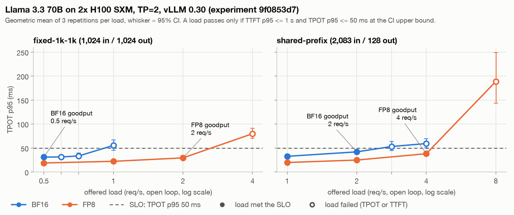

# Serving Llama 3.3 70B under a 50 ms TPOT SLO: from a cross-socket dead end to FP8 on H100

The goal was a production row for Llama 3.3 70B: the cheapest config that holds
**TTFT p95 ≤ 1 s and TPOT p95 ≤ 50 ms** under open-loop load, without a measurable quality
loss against BF16. Every number below is from a stored run (ids in parentheses); the
reports are in [reports/70b-h100-v2](../../reports/70b-h100-v2/leaderboard.md) and the
run notes in [benchmark-lab.md](../benchmark-lab.md#70b-tuning).

## Attempt 1: 4x L40S, TP=4

The first plan was the cheap option: one RunPod Secure pod with 4x L40S ($4.39/h with
storage), BF16 at tensor parallel 4. It never got close.

**What broke.** The first attempt (874110b6) hung at engine start. vLLM's last log line
was `vLLM is using nccl==…`, then nothing until the 1,800 s ready timeout.
`nvidia-smi topo -m` showed why: RunPod had placed GPU0 on one CPU socket and GPUs 1-3 on
the other (`SYS` between them). `torch.cuda.can_device_access_peer` still reported yes for
every pair, but a 4-rank NCCL all-reduce timed out at the default settings, with
`NCCL_P2P_LEVEL=PIX`, with `=NODE` and with `NCCL_SHM_DISABLE=1`. Only
`NCCL_P2P_DISABLE=1` worked: the all-reduce passed in under a second and vLLM TP=4 came up
in 80 s. vLLM turns off its own custom all-reduce on more than two PCIe-only GPUs, so NCCL
was the only peer-to-peer user.

Two changes came out of it. The runner now refuses a multi-GPU RunPod cell unless the
spec sets `NCCL_P2P_DISABLE` or `NCCL_P2P_LEVEL` explicitly (the value is part of the
config hash), and every engine start records the GPU topology, so a hang like this can be
read from the run's events instead of rediscovered.

**The measured floors.** With P2P off, the BF16 run (cf4d1614) met the SLO at no load: at
the lowest load tested, 0.0625 req/s, TPOT p95 was 62.2 ms (geometric mean of three
repetitions; the best single repetition was 60.3 ms). Before calling that a hardware
limit, a 47-minute tuning pod ($3.40) measured where the time goes:

- **Weight reads.** Each decode step reads every GPU's 35 GB weight shard. At the L40S's
  864 GB/s that is at least 41 ms per token before any communication. vLLM's defaults
  were already right: CUDA graphs, `torch.compile` and chunked prefill were all on.
- **Decode all-reduce.** A 16 KB all-reduce (one token's activations) took 27.6 µs over
  the host-memory path, or 4.4 ms across the 160 all-reduces of one token.
  `NCCL_PROTO=LL` cut it to 20.5 µs but doubled 1 MB transfers; `NCCL_ALGO=Tree` gave
  25.1 µs. NCCL tuning was worth about 1 ms per token at most.
- **Prefill all-reduce.** A second diagnostic pod measured 2.76 ms per 32 MB all-reduce,
  so 441 ms of pure communication per 2,048-token prefill (the host path runs at about
  11.6 GB/s). None of `NCCL_SHM_USE_CUDA_MEMCPY`, `NCCL_MIN_NCHANNELS` 8 or 16,
  `NCCL_BUFFSIZE` 16 MB, `NCCL_PROTO=Simple` or `NCCL_ALGO=Tree` helped by more than 5%.

So at batch 1 a token costs about 60 ms on this host, and no knob moves it below 50.

**Speculative decoding helped the median, not the p95.** EAGLE3 with 3 draft tokens looked
like the fix in the tuning pod's 60-90 s windows. The full sweep (55102ddb, 180 s windows,
3 repetitions) overturned it: the median request decoded at 29-48 ms per token, but in
one fixed-1k-1k repetition at 0.25 req/s, 16 of 43 requests ran over 50 ms. Requests
whose continuation the draft cannot predict (random-word content) fall back to the ~60 ms
floor plus the verify overhead, and more than 5% of such requests put the p95 over the
line at any load. The tuning windows had been too short for 1,024-token requests, which
live about 40 s, to reach steady state. EAGLE3's quality was unchanged (teacher-forced KL
0.00022 against BF16 on the 37 of 48 prompts whose greedy outputs matched, below either
config's own noise floor), so the miss was purely latency.

The conclusion: on this host, meeting 50 ms TPOT p95 needs working P2P or NVLink, or
fewer bytes per token. Moving the SLO to fit the hardware was ruled out, since it would
hide the result.

## Attempt 2: 2x H100 SXM, TP=2

The next pod was 2x H100 SXM ($8.02/h with storage), TP=2 over NVLink: each GPU reads its
shard at about 3.35 TB/s and the all-reduce never touches host memory. One experiment
(9f0853d7, $25.18, after three smokes at $6.15) served BF16 first, then restarted warm
onto the FP8 checkpoint (`RedHatAI/Llama-3.3-70B-Instruct-FP8-dynamic`) on the same pod,
so precision is the only difference between the two rows.

| Config | Workload | Goodput at SLO | TPOT p95 at goodput | Output tok/s per replica | $/1M blended [95% CI] |
|---|---|---|---|---|---|
| BF16 | fixed-1k-1k | 0.5 req/s (fails at 0.59) | 31.1 ms | 470 | $2.37 [1.97, 2.84], untrusted |
| FP8 | fixed-1k-1k | 2 req/s (fails at 4) | 29.4 ms | 2,037 | $0.546 [0.532, 0.561] |
| BF16 | shared-prefix | 2 req/s (fails at 2.83) | 42.0 ms | 257 | $0.502 [0.419, 0.601], untrusted |
| FP8 | shared-prefix | 4 req/s (fails at 8) | 38.1 ms | 490 | $0.263 [0.239, 0.289] |

BF16 now meets the SLO, but only at 0.5 req/s on fixed-1k-1k, and its limit there is
TTFT, not TPOT: at 0.59 and 0.71 req/s its TPOT p95 stays at 31-33 ms, while the upper
bound of the TTFT p95 interval runs to tens of seconds. Requests are queueing. Both BF16
figures are flagged untrusted because TTFT p95 varied 21.8% (fixed-1k-1k) and 10.8%
(shared-prefix) across repetitions, above the 10% limit, so the BF16 cost is indicative
only.

FP8 holds 4x the load on fixed-1k-1k on the same pod, and both of its figures are
trusted. Blended cost falls from $2.37 to $0.546 per 1M tokens. The 4x is bounded by the
search grid: FP8 passed 2 req/s and failed 4, so its true knee lies somewhere in between.
A finer capacity search was approved (2b291998), but RunPod had no 2x H100 SXM Secure pod
for its whole two-hour wait, so it spent $0 and measured nothing.

## Making the quality gate decide

A cheaper config ships only if the quality gate shows it is not worse than BF16. For each
task the gate pairs the two configs' scores by item, takes a 95% paired-bootstrap CI of
the difference and widens it to at least ±3/n, the rule of three: n items cannot show
that an effect rarer than about 3/n is absent. PASS needs the CI's lower bound above
−margin; a point drop beyond the margin is FAIL; anything else is INCONCLUSIVE and
blocks the config.

In 9f0853d7 FP8 passed GSM8K, IFEval, tool calling, JSON schema, logprob divergence and
sanity checks, but strict tool calling was INCONCLUSIVE: −1.67 pts [−6.67, +3.33]
against a 6-point margin. That is one item out of 60. With 60 items the CI is at least
±5 points around the delta, so a pass needs a delta of −1 point or better, and one net
lost item is already −1.67. The task could not have passed with any loss at all.

Rerunning would not have helped: tool calls here are deterministic (BF16 and FP8 wrote
byte-identical calls on all 33 plain-mode failures), so replicated passes repeat the same
flip. More items would. The tool-calling set grew from 60 to 135 items (data version 2):
the original 60 unchanged, plus 75 new ones with nested objects, arrays, enums, optional
arguments and strings that look like numbers. Building it also turned up a YAML bug in
version 1 (`e.g. USD` inside a flow mapping had truncated a description and injected a
stray key into 9 items' prompts), now caught by a loader check. At 135 items, FP8 could
lose up to 4 net items and still pass.

The quality-only rerun of both configs (9e5f7866, 24.6 minutes, $3.29) passed every check:

| Task | n | BF16 | FP8 | Delta [95% CI] | Margin | Verdict |
|---|---|---|---|---|---|---|
| GSM8K | 1,319 | 0.955 | 0.955 | +0.08 [−0.61, +0.76] | 1 pt | PASS |
| IFEval | 541 | 0.891 | 0.893 | +0.18 [−1.29, +1.66] | 2 pts | PASS |
| tool calling | 135 | 0.459 | 0.467 | +0.74 [−1.48, +3.70] | 6 pts | PASS |
| tool calling, strict | 135 | 0.444 | 0.459 | +1.48 [−0.74, +3.70] | 6 pts | PASS |
| JSON schema | 300 | 0.973 | 0.977 | +0.33 [−1.00, +2.00] | 3 pts | PASS |

Logprob divergence: KL 0.0040 nats and 98.15% top-1 agreement over 3,015 positions
(limits 0.05 and 95%). The strict item FP8 had lost in the first run passed on both
configs this time, so that flip was not even stable across runs.

The low tool-calling scores (about 0.46 on both) are the model's, not FP8's: Llama 3.3 70B
sends numbers and booleans as JSON strings (`"amount": "250"`). vLLM 0.30's strict mode
never engaged, because xgrammar's Llama trigger expects a call to start with
`{"name": ` and this model starts with `{"type": "function", ...`; 147 of 148 stored strict
failures start that way. The gate compares the two configs on the same items, so this
affects both equally.

## Where that leaves the 70B

FP8 on 2x H100 SXM is the shipped 70B row, and BF16 stays as the reference row. Priced at
cost-plus 20% on the upper bound of each cost CI, it lists at $0.571 per 1M input and
$0.797 per 1M output tokens. That is 0.53x Together AI's $1.04 list price, but our cost
alone is still 2.60x DeepInfra's $0.21 FP8 listing at this mix. At on-demand rates we do
not beat the cheapest providers.

The 70B work cost $48.94 of recorded spend: $14.33 on 4x L40S (874110b6, cf4d1614,
55102ddb) and $34.62 on 2x H100 (three smokes, 9f0853d7 and 9e5f7866), plus the
manual $3.40 tuning pod and the diagnostic pod, which ran outside the runner. The next
levers are proposed but not approved or run: FP8 on a single H200 at TP=1, and EAGLE3
on top of it.
