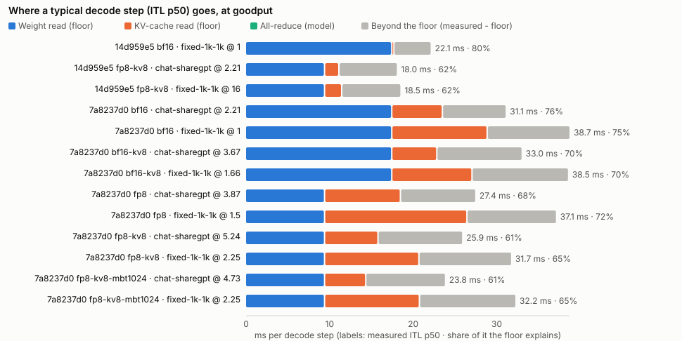

# Roofline: decode-step floors and stored runs

Generated by `bench roofline`. Floors use spec-sheet peaks (`loom_bench.profile.hardware`);
measured figures trace to the run ids in `roofline.json`. Explainer:
[docs/perf/roofline-and-profiling.md](../../docs/perf/roofline-and-profiling.md).

## Floors in theory

Decode-step floor (ms) by batch, every sequence holding 1536 tokens; the largest batch whose floor fits a 50 ms step; a 1,024-token prefill.

| Config | GPU x TP | Weights read / GPU / step | KV / token / GPU | B=1 | B=8 | B=32 | B=64 | B=128 | Max batch at 50 ms | 1k prefill |
|---|---|---|---|---|---|---|---|---|---|---|
| 8B bf16 (bf16 weights, bf16 KV) | L40S x1 | 15.14 GB | 144 KiB | 17.8 | 19.6 | 25.9 | 34.3 | 51.1 | 124 | 43.7 ms |
| 8B bf16-kv8 (bf16 weights, fp8 KV) | L40S x1 | 15.14 GB | 72 KiB | 17.6 | 18.6 | 21.7 | 25.9 | 34.3 | 248 | 43.7 ms |
| 8B fp8 (fp8 weights, bf16 KV) | L40S x1 | 8.19 GB | 144 KiB | 9.7 | 11.6 | 17.9 | 26.3 | 43.0 | 155 | 22.0 ms |
| 8B fp8-kv8 (fp8 weights, fp8 KV) | L40S x1 | 8.19 GB | 72 KiB | 9.6 | 10.5 | 13.7 | 17.9 | 26.3 | 309 | 22.0 ms |
| 70B bf16 TP4 L40S (bf16 weights, bf16 KV) | L40S x4 | 34.75 GB | 80 KiB | 44.8 | 47.3 | 55.9 | 67.4 | 90.4 | 16 | 322.1 ms |
| 70B bf16 TP2 H100 (bf16 weights, bf16 KV) | H100 x2 | 69.50 GB | 160 KiB | 22.4 | 23.0 | 24.9 | 27.5 | 32.7 | 342 | 80.2 ms |
| 70B fp8 TP2 H100 (fp8 weights, bf16 KV) | H100 x2 | 35.28 GB | 160 KiB | 12.2 | 12.8 | 14.7 | 17.3 | 22.5 | 468 | 44.2 ms |

## Stored runs against the floor

Batch and context are rebuilt from each run's per-request rows (token-weighted means over the measurement window); repetitions are averaged. *Achieved* = floor / measured ITL p50 (a typical decode step). *Achieved (mean)* adds the least time prefill takes and compares with the ITL mean. Rows marked **G** are each config's goodput.

| Exp | Cell | Workload | Load | Batch | Context | Floor (w / kv / comm) ms | ITL p50 | ITL mean | TPOT p95 | Achieved | Achieved (mean) | Over floor |
|---|---|---|---|---|---|---|---|---|---|---|---|---|
| 14d959e5 | bf16 | chat-sharegpt | 2.21 | 26.3 | 1251 | 23.2 (17.5 / 5.6 / 0.0) | 30.8 | 35.9 | 41.3 | 75% | 71% | 7.7 |
| 14d959e5 | bf16 | chat-sharegpt | 5.24 | 134.7 | 1254 | 46.2 (17.5 / 28.7 / 0.0) | 66.6 | 109.4 | 118.0 | 69% | 50% | 20.3 |
| 14d959e5 | bf16 | fixed-1k-1k | 1 **G** | 1.0 | 1510 | 17.8 (17.5 / 0.3 / 0.0) | 22.1 | 22.1 | 22.1 | 80% | 81% | 4.3 |
| 14d959e5 | bf16 | fixed-1k-1k | 16 | 15.9 | 1535 | 21.7 (17.5 / 4.2 / 0.0) | 28.2 | 28.8 | 29.1 | 77% | 77% | 6.5 |
| 14d959e5 | bf16 | fixed-1k-1k | 64 | 63.1 | 1528 | 34.0 (17.5 / 16.5 / 0.0) | 45.3 | 48.4 | 49.2 | 75% | 74% | 11.3 |
| 14d959e5 | fp8-kv8 | chat-sharegpt | 2.21 **G** | 15.8 | 1260 | 11.2 (9.5 / 1.7 / 0.0) | 18.0 | 20.4 | 23.2 | 62% | 57% | 6.8 |
| 14d959e5 | fp8-kv8 | chat-sharegpt | 5.24 | 61.3 | 1262 | 16.1 (9.5 / 6.6 / 0.0) | 27.5 | 36.4 | 42.9 | 59% | 50% | 11.4 |
| 14d959e5 | fp8-kv8 | fixed-1k-1k | 1 | 1.0 | 1520 | 9.6 (9.5 / 0.1 / 0.0) | 15.7 | 15.7 | 15.7 | 61% | 61% | 6.0 |
| 14d959e5 | fp8-kv8 | fixed-1k-1k | 16 **G** | 15.8 | 1519 | 11.5 (9.5 / 2.1 / 0.0) | 18.5 | 19.0 | 19.2 | 62% | 62% | 6.9 |
| 14d959e5 | fp8-kv8 | fixed-1k-1k | 64 | 63.1 | 1511 | 17.6 (9.5 / 8.1 / 0.0) | 28.0 | 30.8 | 31.2 | 63% | 60% | 10.4 |
| 7a8237d0 | bf16 | chat-sharegpt | 2 | 22.8 | 1255 | 22.4 (17.5 / 4.9 / 0.0) | 29.5 | 33.7 | 37.7 | 76% | 72% | 7.1 |
| 7a8237d0 | bf16 | chat-sharegpt | 2.21 **G** | 27.2 | 1305 | 23.6 (17.5 / 6.1 / 0.0) | 31.1 | 36.5 | 40.8 | 76% | 72% | 7.5 |
| 7a8237d0 | bf16 | chat-sharegpt | 2.45 | 31.4 | 1225 | 24.1 (17.5 / 6.6 / 0.0) | 31.6 | 37.6 | 44.7 | 76% | 71% | 7.5 |
| 7a8237d0 | bf16 | chat-sharegpt | 3 | 46.8 | 1254 | 27.6 (17.5 / 10.0 / 0.0) | 37.1 | 46.0 | 54.3 | 74% | 68% | 9.6 |
| 7a8237d0 | bf16 | chat-sharegpt | 4.5 | 120.0 | 1233 | 42.8 (17.5 / 25.3 / 0.0) | 61.0 | 91.2 | 112.6 | 70% | 56% | 18.3 |
| 7a8237d0 | bf16 | fixed-1k-1k | 1 **G** | 43.7 | 1530 | 28.9 (17.5 / 11.4 / 0.0) | 38.7 | 41.4 | 43.7 | 75% | 73% | 9.8 |
| 7a8237d0 | bf16 | fixed-1k-1k | 1.11 | 52.4 | 1528 | 31.2 (17.5 / 13.7 / 0.0) | 41.5 | 45.0 | 47.2 | 75% | 73% | 10.3 |
| 7a8237d0 | bf16 | fixed-1k-1k | 1.22 | 59.8 | 1541 | 33.3 (17.5 / 15.7 / 0.0) | 43.8 | 47.9 | 52.1 | 76% | 73% | 10.5 |
| 7a8237d0 | bf16 | fixed-1k-1k | 1.5 | 100.4 | 1521 | 43.6 (17.5 / 26.1 / 0.0) | 57.7 | 68.9 | 75.3 | 76% | 68% | 14.0 |
| 7a8237d0 | bf16-kv8 | chat-sharegpt | 3 | 37.7 | 1252 | 21.6 (17.5 / 4.0 / 0.0) | 30.5 | 37.2 | 42.3 | 71% | 66% | 8.9 |
| 7a8237d0 | bf16-kv8 | chat-sharegpt | 3.67 **G** | 50.5 | 1254 | 22.9 (17.5 / 5.4 / 0.0) | 33.0 | 41.7 | 47.1 | 70% | 64% | 10.1 |
| 7a8237d0 | bf16-kv8 | chat-sharegpt | 3.87 | 52.9 | 1230 | 23.1 (17.5 / 5.6 / 0.0) | 33.2 | 42.6 | 50.2 | 70% | 64% | 10.1 |
| 7a8237d0 | bf16-kv8 | chat-sharegpt | 4.07 | 61.2 | 1242 | 24.0 (17.5 / 6.5 / 0.0) | 34.9 | 45.8 | 53.0 | 69% | 63% | 10.9 |
| 7a8237d0 | bf16-kv8 | chat-sharegpt | 4.5 | 74.8 | 1246 | 25.5 (17.5 / 8.0 / 0.0) | 37.8 | 50.6 | 58.9 | 67% | 62% | 12.3 |
| 7a8237d0 | bf16-kv8 | fixed-1k-1k | 1.5 | 66.0 | 1542 | 26.2 (17.5 / 8.7 / 0.0) | 37.3 | 40.9 | 43.4 | 70% | 68% | 11.1 |
| 7a8237d0 | bf16-kv8 | fixed-1k-1k | 1.66 **G** | 73.3 | 1535 | 27.1 (17.5 / 9.6 / 0.0) | 38.5 | 43.1 | 45.4 | 70% | 68% | 11.4 |
| 7a8237d0 | bf16-kv8 | fixed-1k-1k | 1.84 | 91.3 | 1534 | 29.5 (17.5 / 12.0 / 0.0) | 42.3 | 47.5 | 50.2 | 70% | 68% | 12.8 |
| 7a8237d0 | bf16-kv8 | fixed-1k-1k | 2.25 | 135.5 | 1528 | 35.2 (17.5 / 17.7 / 0.0) | 51.6 | 58.7 | 64.1 | 68% | 67% | 16.3 |
| 7a8237d0 | fp8 | chat-sharegpt | 3 | 28.6 | 1258 | 15.6 (9.5 / 6.2 / 0.0) | 23.1 | 27.5 | 32.9 | 68% | 61% | 7.4 |
| 7a8237d0 | fp8 | chat-sharegpt | 3.67 | 40.9 | 1256 | 18.2 (9.5 / 8.7 / 0.0) | 26.7 | 33.0 | 39.6 | 68% | 60% | 8.5 |
| 7a8237d0 | fp8 | chat-sharegpt | 3.87 **G** | 42.8 | 1235 | 18.6 (9.5 / 9.1 / 0.0) | 27.4 | 33.9 | 41.6 | 68% | 59% | 8.9 |
| 7a8237d0 | fp8 | chat-sharegpt | 4.07 | 52.4 | 1244 | 20.7 (9.5 / 11.2 / 0.0) | 30.3 | 38.5 | 46.8 | 68% | 59% | 9.7 |
| 7a8237d0 | fp8 | chat-sharegpt | 4.5 | 72.3 | 1248 | 24.9 (9.5 / 15.4 / 0.0) | 36.3 | 47.6 | 60.8 | 69% | 58% | 11.4 |
| 7a8237d0 | fp8 | fixed-1k-1k | 1.5 **G** | 64.9 | 1539 | 26.5 (9.5 / 17.0 / 0.0) | 37.1 | 40.4 | 44.6 | 72% | 68% | 10.6 |
| 7a8237d0 | fp8 | fixed-1k-1k | 1.66 | 75.9 | 1529 | 29.3 (9.5 / 19.8 / 0.0) | 39.8 | 45.1 | 50.4 | 74% | 67% | 10.6 |
| 7a8237d0 | fp8 | fixed-1k-1k | 1.84 | 111.7 | 1498 | 38.1 (9.5 / 28.6 / 0.0) | 49.6 | 64.0 | 81.8 | 77% | 62% | 11.5 |
| 7a8237d0 | fp8 | fixed-1k-1k | 2.25 | 133.7 | 1533 | 44.4 (9.5 / 34.9 / 0.0) | 62.5 | 88.9 | 98.7 | 71% | 51% | 18.1 |
| 7a8237d0 | fp8-kv8 | chat-sharegpt | 4.5 | 44.5 | 1252 | 14.3 (9.5 / 4.8 / 0.0) | 23.1 | 29.4 | 35.5 | 62% | 53% | 8.8 |
| 7a8237d0 | fp8-kv8 | chat-sharegpt | 4.98 | 58.8 | 1255 | 15.8 (9.5 / 6.3 / 0.0) | 25.8 | 34.1 | 40.4 | 61% | 52% | 10.0 |
| 7a8237d0 | fp8-kv8 | chat-sharegpt | 5.24 **G** | 59.4 | 1255 | 15.9 (9.5 / 6.4 / 0.0) | 25.9 | 34.3 | 41.4 | 61% | 52% | 10.0 |
| 7a8237d0 | fp8-kv8 | chat-sharegpt | 5.51 | 69.5 | 1256 | 16.9 (9.5 / 7.5 / 0.0) | 27.7 | 37.8 | 45.1 | 61% | 51% | 10.7 |
| 7a8237d0 | fp8-kv8 | chat-sharegpt | 6.75 | 114.9 | 1250 | 21.8 (9.5 / 12.3 / 0.0) | 36.4 | 51.7 | 63.7 | 60% | 49% | 14.7 |
| 7a8237d0 | fp8-kv8 | fixed-1k-1k | 1.5 | 42.1 | 1542 | 15.0 (9.5 / 5.5 / 0.0) | 24.1 | 25.6 | 27.5 | 62% | 61% | 9.1 |
| 7a8237d0 | fp8-kv8 | fixed-1k-1k | 2.25 **G** | 86.0 | 1538 | 20.8 (9.5 / 11.3 / 0.0) | 31.7 | 35.9 | 39.7 | 65% | 61% | 10.9 |
| 7a8237d0 | fp8-kv8 | fixed-1k-1k | 2.76 | 125.1 | 1534 | 25.9 (9.5 / 16.4 / 0.0) | 39.7 | 45.6 | 49.2 | 65% | 60% | 13.8 |
| 7a8237d0 | fp8-kv8 | fixed-1k-1k | 3.38 | 206.9 | 1510 | 36.2 (9.5 / 26.7 / 0.0) | 56.3 | 65.3 | 72.3 | 64% | 60% | 20.1 |
| 7a8237d0 | fp8-kv8-mbt1024 | chat-sharegpt | 4.5 | 45.5 | 1252 | 14.4 (9.5 / 4.9 / 0.0) | 23.6 | 30.1 | 36.6 | 61% | 53% | 9.3 |
| 7a8237d0 | fp8-kv8-mbt1024 | chat-sharegpt | 4.73 **G** | 46.3 | 1241 | 14.4 (9.5 / 4.9 / 0.0) | 23.8 | 30.5 | 37.0 | 61% | 52% | 9.4 |
| 7a8237d0 | fp8-kv8-mbt1024 | chat-sharegpt | 4.98 | 60.1 | 1255 | 15.9 (9.5 / 6.4 / 0.0) | 26.6 | 34.8 | 41.5 | 60% | 51% | 10.6 |
| 7a8237d0 | fp8-kv8-mbt1024 | chat-sharegpt | 5.51 | 71.3 | 1256 | 17.1 (9.5 / 7.7 / 0.0) | 29.0 | 38.8 | 46.1 | 59% | 50% | 11.9 |
| 7a8237d0 | fp8-kv8-mbt1024 | chat-sharegpt | 6.75 | 124.0 | 1249 | 22.7 (9.5 / 13.3 / 0.0) | 44.5 | 56.0 | 69.4 | 51% | 47% | 21.8 |
| 7a8237d0 | fp8-kv8-mbt1024 | fixed-1k-1k | 1.5 | 42.1 | 1542 | 15.0 (9.5 / 5.5 / 0.0) | 24.1 | 25.6 | 27.5 | 62% | 61% | 9.1 |
| 7a8237d0 | fp8-kv8-mbt1024 | fixed-1k-1k | 2.25 **G** | 86.5 | 1537 | 20.8 (9.5 / 11.4 / 0.0) | 32.2 | 36.2 | 40.0 | 65% | 61% | 11.4 |
| 7a8237d0 | fp8-kv8-mbt1024 | fixed-1k-1k | 2.76 | 127.4 | 1533 | 26.2 (9.5 / 16.7 / 0.0) | 41.3 | 46.7 | 50.6 | 63% | 60% | 15.1 |
| 7a8237d0 | fp8-kv8-mbt1024 | fixed-1k-1k | 3.38 | 213.1 | 1509 | 37.0 (9.5 / 27.5 / 0.0) | 61.6 | 67.9 | 75.6 | 60% | 59% | 24.6 |

## Fixed and per-sequence step cost

ITL p50 (less the modelled all-reduce) fitted as fixed + per-sequence x batch over each cell's load points. The fixed part's floor is the weight read; the per-sequence part's is that sequence's KV read.

| Exp | Cell | Workload | Points | Fixed ms (floor) | Per sequence ms (floor) | Per-seq / floor | R² |
|---|---|---|---|---|---|---|---|
| 14d959e5 | bf16 | fixed-1k-1k | 3 | 22.0 (17.5) | 0.370 (0.260) | 1.42x | 0.999 |
| 14d959e5 | fp8-kv8 | fixed-1k-1k | 3 | 15.4 (9.5) | 0.199 (0.130) | 1.54x | 1.000 |
| 7a8237d0 | bf16 | chat-sharegpt | 5 | 21.9 (17.5) | 0.326 (0.215) | 1.52x | 0.999 |
| 7a8237d0 | bf16 | fixed-1k-1k | 4 | 23.9 (17.5) | 0.336 (0.261) | 1.29x | 1.000 |
| 7a8237d0 | bf16-kv8 | chat-sharegpt | 5 | 22.9 (17.5) | 0.198 (0.106) | 1.86x | 0.997 |
| 7a8237d0 | bf16-kv8 | fixed-1k-1k | 4 | 23.4 (17.5) | 0.207 (0.131) | 1.58x | 1.000 |
| 7a8237d0 | fp8 | chat-sharegpt | 5 | 14.4 (9.5) | 0.303 (0.214) | 1.42x | 1.000 |
| 7a8237d0 | fp8 | fixed-1k-1k | 4 | 13.1 (9.5) | 0.354 (0.260) | 1.36x | 0.963 |
| 7a8237d0 | fp8-kv8 | chat-sharegpt | 5 | 14.5 (9.5) | 0.190 (0.107) | 1.77x | 1.000 |
| 7a8237d0 | fp8-kv8 | fixed-1k-1k | 4 | 15.3 (9.5) | 0.197 (0.131) | 1.50x | 0.999 |
| 7a8237d0 | fp8-kv8-mbt1024 | chat-sharegpt | 5 | 10.9 (9.5) | 0.267 (0.107) | 2.50x | 0.994 |
| 7a8237d0 | fp8-kv8-mbt1024 | fixed-1k-1k | 4 | 13.9 (9.5) | 0.221 (0.131) | 1.69x | 0.997 |

## Time to first token at the lightest load

TTFT p50 at each cell's lowest load point against the prefill floor for the mean prompt (FLOPs at the tensor peak plus TP all-reduce). The engine was still decoding other requests at these loads (batch shown), so a prompt shares its steps with them and the gap is not all prefill inefficiency. Workloads with prefix caching (shared-prefix) are left out: their uncached share varies per request.

| Exp | Cell | Workload | Load | Decode batch | Prompt | Floor ms | TTFT p50 ms | Floor / TTFT |
|---|---|---|---|---|---|---|---|---|
| 14d959e5 | bf16 | chat-sharegpt | 2.21 | 26.3 | 950 | 40 | 170 | 24% |
| 14d959e5 | bf16 | fixed-1k-1k | 1 | 1.0 | 1024 | 44 | 88 | 50% |
| 14d959e5 | fp8-kv8 | chat-sharegpt | 2.21 | 15.8 | 950 | 20 | 113 | 18% |
| 14d959e5 | fp8-kv8 | fixed-1k-1k | 1 | 1.0 | 1024 | 22 | 70 | 31% |
| 7a8237d0 | bf16 | chat-sharegpt | 2 | 22.8 | 930 | 40 | 162 | 24% |
| 7a8237d0 | bf16 | fixed-1k-1k | 1 | 43.7 | 1024 | 44 | 185 | 24% |
| 7a8237d0 | bf16-kv8 | chat-sharegpt | 3 | 37.7 | 962 | 41 | 183 | 22% |
| 7a8237d0 | bf16-kv8 | fixed-1k-1k | 1.5 | 66.0 | 1024 | 44 | 184 | 24% |
| 7a8237d0 | fp8 | chat-sharegpt | 3 | 28.6 | 962 | 21 | 135 | 15% |
| 7a8237d0 | fp8 | fixed-1k-1k | 1.5 | 64.9 | 1024 | 22 | 173 | 13% |
| 7a8237d0 | fp8-kv8 | chat-sharegpt | 4.5 | 44.5 | 956 | 20 | 144 | 14% |
| 7a8237d0 | fp8-kv8 | fixed-1k-1k | 1.5 | 42.1 | 1024 | 22 | 127 | 17% |
| 7a8237d0 | fp8-kv8-mbt1024 | chat-sharegpt | 4.5 | 45.5 | 956 | 20 | 186 | 11% |
| 7a8237d0 | fp8-kv8-mbt1024 | fixed-1k-1k | 1.5 | 42.1 | 1024 | 22 | 160 | 14% |

## Why fp8-kv8 serves 2.37x bf16 on chat-sharegpt

- Goodput: bf16 2.21 req/s, fp8-kv8 5.24 req/s.
- A step costs 21.9 ms fixed + 0.326 ms per sequence on bf16, 14.5 + 0.190 on fp8-kv8.
- Within bf16's step at goodput (31.1 ms ITL p50), that is 28 sequences on bf16 and 87 on fp8-kv8: **3.09x** if decode were the only work.
- The latency tail takes part back: TPOT p95 / ITL p50 is 1.31 on bf16 and 1.60 on fp8-kv8. Prefill's floor is 10% vs 11% of the time; the mean-vs-median ITL gap implies 15% vs 25%.
- bf16 fails at 2.45 req/s on its CI upper bound only (the mean passes) (KV cache 19% full; the cache holds ~178k tokens).
- fp8-kv8 fails at 5.51 req/s on its CI upper bound only (the mean passes) (KV cache 18% full; the cache holds ~439k tokens).

## Why fp8-kv8 serves 2.25x bf16 on fixed-1k-1k

- Goodput: bf16 1 req/s, fp8-kv8 2.25 req/s.
- A step costs 23.9 ms fixed + 0.336 ms per sequence on bf16, 15.3 + 0.197 on fp8-kv8.
- Within bf16's step at goodput (38.7 ms ITL p50), that is 44 sequences on bf16 and 119 on fp8-kv8: **2.69x** if decode were the only work.
- The latency tail takes part back: TPOT p95 / ITL p50 is 1.13 on bf16 and 1.25 on fp8-kv8. Prefill's floor is 5% vs 5% of the time; the mean-vs-median ITL gap implies 7% vs 12%.
- bf16 fails at 1.11 req/s on its CI upper bound only (the mean passes) (KV cache 40% full; the cache holds ~178k tokens).
- fp8-kv8 fails at 2.76 req/s on its CI upper bound only (the mean passes) (KV cache 38% full; the cache holds ~439k tokens).
